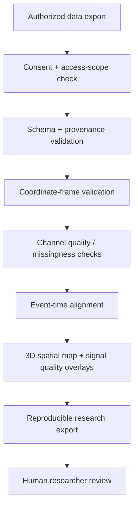

# Neura-Mapper — BCI research mapping concept

## What it can help with

Neura-Mapper currently contains a 3D voxel classification and safest-path prototype. A useful extension for brain-computer-interface research is a **spatial research-data workbench** that maps authorized channel/electrode metadata onto a consistent 3D coordinate frame.

For Neuralink-style research, this could help a research team:
- visualize authorized electrode/channel locations and their geometry;
- annotate channel-level signal quality, missing data and artifact flags;
- align recording sessions with experiment/task event markers;
- compare de-identified sessions without mixing coordinate frames or participants;
- inspect spatial gaps and channel-health patterns before decoding experiments;
- export reproducible figures and metadata for human review.

This is a research workflow, not an implant integration.

## What it does not do

- No public Neuralink raw-signal or implant-control API is assumed.
- No reverse engineering of implant firmware, radio protocols or device security.
- No inference of private thoughts from unrelated data.
- No diagnosis, treatment recommendation or clinical outcome claim.
- No access to identifiable participant data without appropriate authorization, consent, governance and security controls.

The public Neuralink VOICE study page describes an investigational N1 implant programme for speech restoration in eligible participants. That does not imply a public developer API or access to raw implant data: https://neuralink.com/trials/speech-restoration/

## Data pipeline

## Example spatial layout

    3D RESEARCH MAP — CONCEPT ONLY
           posterior
              ↑
       [E01] [E02] [E03]      Each marker:
          \    |    /         channel ID
           \   |   /          xyz coordinate + frame
            [ARRAY]            signal quality / flags
           /   |   \
       [E04] [E05] [E06]
              ↓
           anterior

A map must display the coordinate frame, units, transform, source dataset and uncertainty. Do not place electrodes using guessed anatomical coordinates.

## Input contract

See examples/bci-session.schema.json. Every session requires a pseudonymous participant code, authorization scope, source provenance, coordinate frame and units. Signal files remain external; the schema stores references and metadata rather than raw neural time series.

## Next implementation gates

1. Add strict coordinate-frame and unit handling.
2. Implement authorized session import with schema validation.
3. Add channel-quality and missingness overlays to the existing 3D visualizer.
4. Add deterministic synthetic fixtures, clearly labelled as synthetic.
5. Validate on approved, de-identified research exports and obtain domain review before claiming BCI utility.
